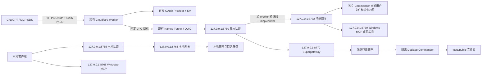

# Windows MCP — 本地部署与免费公网本人授权入口

这是可公开发布的模板。部署前请将 `<PROJECT_ROOT>`、`your-worker.workers.dev` 以及 Cloudflare 资源占位符替换为本机或账户配置；密钥、令牌、备份和运行日志必须留在本地受保护目录。

部署目录：`<PROJECT_ROOT>`。公网地址：**https://your-worker.workers.dev/mcp**。

原只读版本已经通过 ChatGPT 现有 Primary 连接的真实 list_directory 和 read_file 验收，完整读到 MCP_MODIFIED。用户随后明确授权新增文件创建/修改/删除、PowerShell/CMD、鼠标/键盘/截屏；新增控制权限使用独立的 `mcp:control` 同意与开关，**旧只读授权不会升级**。本轮实际状态、验收和现有连接追加授权步骤见 [本人控制权限](docs/owner-control.md)。`/healthz` 的 `mcp_enabled`、`control_auth_enabled`、`control_enabled` 分别表示总入口、新增 scope 和公网控制开关；以实时值为准。

GitHub 登录使用新的一轮、单次本地入口 `http://127.0.0.1:8790/start`，全程保持同一浏览器窗口与配置文件，不复用旧授权页。新版在显示同意按钮前确认浏览器已发回安全 Cookie，并区分过期事务与 Cookie 缺失；详情见 [browser_binding 调查与修复](docs/browser-binding-fix.md)。

新增权限返回 ChatGPT 时曾提示“缺少 OAuth 回调数据”，后台已验证控制 Token 换取成功，后续 OpenAI 客户端工具发现也返回 200/control；请从正常插件列表进入连接刷新，并在新聊天验收，勿重放旧回调。证据与恢复步骤见 [ChatGPT 回调调查](docs/chatgpt-callback-diagnostic.md)。

## 架构与版本



| 组件 | 固定版本 / 位置 |
|---|---|
| Desktop Commander | 0.2.51；`gateway/node_modules` |
| Supergateway | 4.0.0；`gateway/node_modules` |
| MCP 官方 TypeScript SDK | 1.30.1 |
| MCP 官方模块 SDK | server/client 2.0.0；公共服务支持 2026-07-28，保留旧握手 |
| Cloudflare workers-oauth-provider | 1.1.0 |
| Wrangler | 4.141.0 |
| cloudflared | 2026.9.3；`runtime/cloudflared/cloudflared.exe` |
| Windows-MCP | 0.8.5；`runtime/windows-mcp` 独立 Python 3.12 环境 |
| Node.js | 24.11.0；现有系统安装 |

上游包保持原样。少量适配代码负责权限边界、认证、进程恢复和任务持久化。Supergateway 默认监听所有接口，因此通过 `loopback.cjs` 强制绑定回环地址。只读、控制和原本地网关使用独立 Commander 配置。原 8768 Windows-MCP 留在本机；新增 8769 桌面服务仅通过经过本人控制授权的策略网关访问，不直接映射 Tunnel。

## 身份、权限与密钥

只允许预先绑定的 GitHub 账号。绑定使用 GitHub 不可变用户 ID，而不是用户名；OAuth App 只请求 `read:user`。Worker 从 GitHub 官方 `/user` 获取 ID 并严格匹配，其他账号拒绝。Client Secret 只保存于受 ACL 保护的本地 `secrets/identity-client.json` 和 Worker Secret，未写入源代码。公开仓库不包含账号 ID、Client Secret 或任何 Token。

MCP 与 GitHub 两段授权都使用 S256 PKCE、浏览器绑定状态、单次授权码与同意页面。官方 OAuth Provider 管理 Token、加密授权属性和 KV 存储。MCP Access Token 有效期 **900 秒**，Refresh Token 有效期 **86400 秒**；刷新时重新验证 GitHub 身份。GitHub Token 被撤销或 ID 不符时拒绝刷新；现有 MCP Access Token 最长还可存活到自身过期。

RFC 7009 撤销使用元数据公布的 `/token` 端点，撤销 Refresh Token 对应的授权。KV 跨区域最终一致性可能使撤销传播延迟约 60 秒。不要把它描述成全球瞬时撤销；必要时运行默认部署关闭公网入口。未认证、伪造 Token、错误身份、错误 scope、错误 resource、缺失配置以及上游失败均拒绝访问。

Client Secret 不进入 Git 历史；部署时从本机受保护文件读取并通过 Wrangler Secret 写入 Worker。若凭据曾经出现在聊天、截图或日志中，应在 GitHub 设置中撤销并重新生成，不能把旧凭据提交到仓库。代码与日志检查不输出 Secret 值。

`mcp:read` 授权的文件边界仍为 **`<PROJECT_ROOT>\tests\public`**，只读 Commander 启动必须匹配该目录。可读取/列目录/搜索及查询本项目任务；启用控制配置后还可发现 `request_control_access`，它只触发新增 OAuth 同意，不执行控制操作。任务日志应只包含可公开给本人的测试内容。

旧 `mcp:read` 授权仍拒绝写文件、命令和桌面操作，伪造控制路由头不能升级权限；目录外及 URL 读取被拒绝。新 `mcp:read mcp:control` 授权经 GitHub 本人重新同意，且公网控制开关开启后，才可使用文件、终端、进程、固定任务配方及桌面工具。**控制权限的文件/程序范围是当前 Windows 用户可访问的范围，不能承诺只限测试目录**；服务不提升管理员权限，工具不暴露配置修改，`delete_file` 只删除指定文件、不递归删除文件夹，URL 文件读取仍拒绝。命令工具本身可以调用当前用户权限内的程序和网络。请求体限制 2 MiB；本机认证还校验 Host 并拒绝浏览器 Origin。

## 免费方案

保留 Worker `gpt-mcp-worker`、Named Tunnel `gpt-mcp-tunnel` 与 Workers VPC 服务 `gpt-mcp-readonly`。不使用 Cloudflare Access，不依赖 Team domain/AUD，不购买域名、不配置银行卡、不申请付费套餐。`workers.dev` 作为 Worker 地址，Worker 通过官方 VPC binding 访问 Tunnel；无需将 Tunnel 直接绑定此域名。

按 [Workers 定价](https://developers.cloudflare.com/workers/platform/pricing/) 与 [KV 定价](https://developers.cloudflare.com/kv/platform/pricing/)，Free 有请求及 KV 操作额度；耗尽额度会造成不可用，请勿升级付费以绕过。Workers VPC [当前 Open Beta 免费](https://developers.cloudflare.com/workers-vpc/platform/pricing/)，未来定价可能改变，届时需重新评估并可关闭入口。

此次没有执行套餐升级、购买或付款操作。账户订阅 API 返回 403，无法仅凭 `default_usage_model=standard` 判断 Free/Paid；请在 Cloudflare 控制台确认当前 Workers 仍为 Free。审计见 `docs/cloudflare-plan-audit.json`。

## 管理命令

在资源管理器中双击根目录的 `start-service.cmd` 启动服务，双击 `stop-service.cmd` 关闭服务。使用普通用户运行即可；启动脚本会拒绝管理员权限。窗口会保留执行结果，按任意键关闭。

两个入口分别调用现有 `scripts/start.ps1` 和 `scripts/stop.ps1`，从任意工作目录运行均可。启动入口使用默认权限，也可在命令行追加原启动脚本的参数。关闭入口会停止本机服务及 Tunnel，保留独立任务；Worker 公网开关仍由部署脚本管理。

### 下次开机：启动与使用

1. 登录当前 Windows 用户并保持桌面会话。已安装的计划任务 `GPT-MCP-Local` 会在**登录时**以普通用户权限运行 `scripts\start.ps1`；无需重新部署 Worker、创建 Tunnel 或注册 OAuth App。它不是开机后、尚未登录时运行的系统服务。
2. 打开**非管理员** PowerShell，检查服务：

   ```powershell
   Set-Location <PROJECT_ROOT>
   powershell.exe -NoProfile -ExecutionPolicy Bypass -File .\scripts\status.ps1
   ```

   正常情况下，`Running`、`TunnelReady`、`PublicMcpEnabled`、`PublicControlEnabled` 均为 `true`。`PublicMcpEnabled` 和 `PublicControlEnabled` 来自实时公网 `/healthz`；网络或代理暂时不可达时可能为 `null`，不能仅凭 `null` 判断 Worker 已关闭。计划任务显示 `Ready` 也不代表服务进程正在运行，应以 `Running` 和 `TunnelReady` 为准。
3. 若 `Running` 为 `false`，在同一普通用户 PowerShell 手动启动，再检查状态：

   ```powershell
   powershell.exe -NoProfile -ExecutionPolicy Bypass -File .\scripts\start.ps1
   powershell.exe -NoProfile -ExecutionPolicy Bypass -File .\scripts\status.ps1
   ```

   如果启动脚本提示已运行，无需重复启动。若 `Running=true` 但 `TunnelReady=false`，先等待 Supervisor 恢复子进程，再查 `logs` 中本项目的 supervisor/tunnel 日志；不要重建现有连接。
4. 在 ChatGPT 新聊天中启用现有 **My Windows PC Read Only / Primary** 连接并调用工具。当前连接虽沿用这个名称，刷新后应显示 **35 个工具**，包含 `read_file`、`write_file`、`start_process`、`desktop_Screenshot` 等。先用 `list_directory` 查看 `<PROJECT_ROOT>\tests\public`，再用 `read_file` 读取 `<PROJECT_ROOT>\tests\public\mcp-sample.txt`，核对 `MCP_MODIFIED`。若工具列表仍是旧的 12 个，从 ChatGPT 个人插件列表进入现有连接点 **Refresh**，然后新建聊天；不要删除连接或复用旧 OAuth 回调页。
5. 文件修改、命令和桌面操作只有已获得 `mcp:read mcp:control` 的本人授权连接才能调用。它们使用当前 Windows 用户权限；执行前确认目标文件或命令。桌面鼠标、键盘和截图需要保持该用户的交互式桌面会话，锁屏或未登录时不要预期桌面操作成功。**35 个工具可见已由 ChatGPT 确认，ChatGPT 内的写入、命令和桌面实际操作仍待逐项验收。**

网关会把 Streamable HTTP 会话保留 1 小时。这样 ChatGPT 长时间思考后继续调用时，不会因为默认的 5 分钟空闲清理而显示 MCP 连接断开；客户端主动发送 `DELETE` 或服务重启仍会结束会话。若电脑网络短暂中断，Supervisor 会保留并自动拉起 Tunnel 子进程，恢复后再从 ChatGPT 刷新连接即可。

Supervisor 还每 15 秒检查 Tunnel 的本地 `/ready` 指标。如果 `cloudflared` 进程仍在但活动连接为 0，连续 45 秒未恢复时只重启 Tunnel 子进程，不会重启 MCP 网关、OAuth 或桌面服务。Workers VPC 使用 `auto`/`quic` 所需的 Tunnel 传输；不要强制改成固定 HTTP/2。检查状态：

```powershell
powershell.exe -NoProfile -ExecutionPolicy Bypass -File .\scripts\status.ps1
```

`TunnelReady=true` 表示本地 Tunnel 至少有一条活动连接；`false` 时等待 Supervisor 自动恢复，或查看 `logs\tunnel.log` 中的 Cloudflare 连接预检结果。

需要停止本机服务时运行 `powershell.exe -NoProfile -ExecutionPolicy Bypass -File .\scripts\stop.ps1`。这会断开本机到公网入口的转发；再次使用时运行 `start.ps1`。仅仅停止本机服务不会改变 Worker 的公网开关；如需关闭公网控制或整个公网 MCP，使用下方“管理命令”所述的部署开关。

在**非管理员** PowerShell 执行：

```powershell
Set-Location <PROJECT_ROOT>
powershell.exe -NoProfile -ExecutionPolicy Bypass -File scripts\start.ps1
powershell.exe -NoProfile -ExecutionPolicy Bypass -File scripts\status.ps1
powershell.exe -NoProfile -ExecutionPolicy Bypass -File scripts\restart.ps1
powershell.exe -NoProfile -ExecutionPolicy Bypass -File scripts\stop.ps1
```

默认本地也只读。本人明确需要本地写入/执行或桌面输入时：

```powershell
powershell.exe -NoProfile -ExecutionPolicy Bypass -File scripts\restart.ps1 -EnableWriteAndExec -EnableDesktopControl
```

操作后用不带开关的 `restart.ps1` 恢复原 8765/8768 本地入口默认权限。**这不会关闭独立的公网控制服务**；新增控制本地服务由 `config/public-control.json.enabled` 管理，公网还由 Worker 控制开关与新授权共同管理。关闭公网控制执行 `deploy-worker.ps1 -EnablePublicReadOnly`；关闭所有公网执行默认 `deploy-worker.ps1`。桌面服务处于当前用户会话，不在 SYSTEM/Session 0 下运行。

计划任务 `GPT-MCP-Local` 在当前用户登录时以 Limited 权限启动。已经实际测试计划任务启动，**没有完成物理重启验收**；登录前不会提供桌面服务。Supervisor 独立重启故障子进程，退避 2–60 秒；Supervisor 自身被杀后需要手动启动或下次登录恢复。

## 持久任务

`config/task-recipes.json` 固定命令、目录和参数。旧只读授权不能提交任务；新控制授权允许执行已配置配方，但不能修改配方。本人可在本机运行：

```powershell
powershell.exe -NoProfile -ExecutionPolicy Bypass -File scripts\task.ps1 -Action recipes
powershell.exe -NoProfile -ExecutionPolicy Bypass -File scripts\task.ps1 -Action submit -Recipe long-test -Key my-test-001
powershell.exe -NoProfile -ExecutionPolicy Bypass -File scripts\task.ps1 -Action status -TaskId "返回的task_id"
powershell.exe -NoProfile -ExecutionPolicy Bypass -File scripts\task.ps1 -Action log -TaskId "返回的task_id"
```

相同幂等键返回相同任务，避免重复执行。状态和退出码保存在 `tasks/state`，stdout/stderr 持久化、每路上限 10 MiB，查询尾部上限 64 KiB。任务使用独立进程，客户端断开/网关重启不取消任务。机器重启后不自动重放未完成命令，失去心跳的任务标记失败。CMake 验收使用本项目测试工程，不代表任何硬件工程已编译或刷写。

## 测试与公网开关

```powershell
powershell.exe -NoProfile -ExecutionPolicy Bypass -File scripts\test-local.ps1
node gateway\test-readonly.mjs
node gateway\test-oauth.mjs
powershell.exe -NoProfile -ExecutionPolicy Bypass -File scripts\test-remote.ps1 -ProbeOnly
powershell.exe -NoProfile -ExecutionPolicy Bypass -File scripts\test-remote.ps1 -LoginOnly
```

完整 OAuth 安全测试包含真实 60 秒 Token 到期等待；`--quick` 跳过到期测试，不能用作开启公网的依据。该测试在本地 workerd 使用模拟 GitHub 身份、真实 MCP 服务；真实 GitHub 登录单独记录。

`deploy-worker.ps1 -EnablePublicReadOnly` 必须检查完整 OAuth 报告、公共只读报告和匹配当前身份配置的真实 GitHub 登录报告。开启后运行：

```powershell
powershell.exe -NoProfile -ExecutionPolicy Bypass -File scripts\test-remote.ps1 -RecoverTunnel -Revoke
```

它实际发现工具、读取测试文件、拒绝危险工具及目录外文件、断开并创建新会话，停止本项目 Tunnel 进程并验证自动恢复及本地任务保留，再撤销 SDK 授权并验证 Access/Refresh 拒绝。该故障测试不关闭物理网卡或现有 Clash。撤销该 SDK 授权不影响独立 ChatGPT 授权。关闭公网：

```powershell
powershell.exe -NoProfile -ExecutionPolicy Bypass -File scripts\deploy-worker.ps1
```

## ChatGPT 网页端实际添加

以下操作依据 2026-09-26 [OpenAI 官方 Quickstart](https://developers.openai.com/plugins/quickstart) 和 [OAuth 文档](https://developers.openai.com/plugins/build/auth)。界面功能受当前账号/工作区权限影响，必须以你的实际界面为准。

1. 登录 ChatGPT，Settings → Security and login → 开启 Developer mode。
2. 打开 **https://chatgpt.com/plugins**，点加号添加个人 MCP；名称 `My Windows PC Read Only`。
3. MCP server URL 填 **https://your-worker.workers.dev/mcp**，认证选 **OAuth**。使用自动发现/自动客户端注册，不填写 GitHub Client Secret。
4. 创建并连接，完成 Worker 同意页和 GitHub 登录。只允许 绑定的 GitHub 账号。
5. 打开 **https://chatgpt.com/plugins?view=personal**，找到插件，点加号安装到自己的账号。
6. 回首页切换 **Work**，新建聊天，输入 `@` 并选择本插件，发送下面的验收提示。

现有 Primary 只读连接的读取测试只需 **Refresh** 和新聊天。**新增控制需要追加 OAuth 同意**：先刷新现有连接，在启用此连接的新聊天中明确调用 `request_control_access`，完成本人控制同意，再刷新并新建聊天。不要删除连接或重新注册 OAuth App。具体验收提示见 [本人控制权限](docs/owner-control.md)；刷新流程见 [Connect and test](https://developers.openai.com/plugins/deploy/connect-chatgpt)，追加权限的工具声明和 OAuth challenge 依据 [官方认证流程](https://developers.openai.com/plugins/build/auth#triggering-authentication-ui)。

```text
使用 My Windows PC Read Only，调用 list_directory 查看 <PROJECT_ROOT>\tests\public，
然后调用 read_file 读取 <PROJECT_ROOT>\tests\public\mcp-sample.txt。
请报告实际工具调用结果和文件中的 MCP_MODIFIED 标记。
如果当前授权仍只有 mcp:read，随后尝试调用 write_file 和 start_process，确认拒绝。
```

要确认真实调用卡片、读取内容和拒绝结果，不能仅接受模型口头宣称。若没有 Developer mode、加号或 Work，记录账户套餐/工作区与可见界面；当前账号能力尚不能通过公网 SDK 测试证明，也不会要求额外购买 OpenAI API Token。

## 日志、备份、恢复与卸载

日志在 `logs`，子进程日志每文件 10 MiB 并保留一份轮换；凭据与 OAuth 缓存在 `secrets`（仅当前用户和 SYSTEM 可访问），不复制进公开资料。`tests/*-result.json` 是验收证据，`tests/*.png` 是本地桌面测试截图，均不位于 public 文件夹。不要公开 `secrets`、`backups`、完整日志或桌面截图。

`scripts/backup.ps1` 备份源码、配置、文档和任务状态，排除凭据、node_modules 与运行时；恢复这些文件前先停止服务。凭据需单独离线安全保存。原 Codex/OpenCodex/Clash 配置备份在 `backups/before-deployment`；原 Worker 内容和 settings 在 `backups/worker-before`，恢复 Worker 需要按 Cloudflare multipart 上传格式重新部署，不是直接运行备份文件。

`scripts/uninstall.ps1` 停止本项目并删除本项目计划任务/Startup 快捷方式，保留文件、凭据和任务记录。项目 `.codex/config.toml` 的 `my_windows_pc_local` 条目仍需按需移除。云端资源保留；如要停止公网，请先运行默认 `deploy-worker.ps1`。没有删除原 Remote Desktop Commander/McpManagementService。

已有全局 Codex、OpenCodex、代理配置未由本项目修改，项目 Codex 配置只添加本目录的只读 stdio 服务。Windows 防火墙在部署前已是关闭状态，本项目没有改变它；全部服务仍只绑定回环，未新增入站放行规则。

## 从公开仓库重新部署

公开仓库只保存可审计的源代码、脚本、配置模板和文档。它刻意不包含 `secrets/`、`runtime/`、`gateway/node_modules/`、`logs/`、`backups/`、本机配置、Token、OAuth 授权记录或测试截图。重新部署时应使用自己的 Windows 用户和自己的 Cloudflare/GitHub 账号，不要复制这些被忽略的目录。

### 1. 准备运行环境

在 Windows 安装 Node.js 24、Python 3.12、Git、Wrangler 和 cloudflared。将 Windows-MCP 安装到项目约定的 Python 3.12 虚拟环境，并将 cloudflared 放到 `runtime/cloudflared/cloudflared.exe`；这些运行时文件不通过 Git 分发。安装依赖后，在项目目录执行：

```powershell
Set-Location <PROJECT_ROOT>
npm --prefix .\gateway install --omit=dev
```

如果使用不同路径，修改本地配置和脚本中的路径后再启动；不要把个人路径、代理密码或 Token 写入仓库。

### 2. 创建本机凭据和配置

创建 GitHub OAuth App，回调地址必须是当前 Worker 的 `/callback`。然后用隐藏输入脚本保存 Client ID 和 Client Secret：

```powershell
powershell.exe -NoProfile -ExecutionPolicy Bypass -File .\scripts\configure-identity.ps1 -GitHubUsername "你的GitHub用户名"
```

脚本只在本机保存受 ACL 保护的凭据，并以不可变 GitHub 用户 ID 绑定账号。不要把脚本提示中的 Secret 复制到聊天、README、Issue 或 Git 提交中。

Named Tunnel 和 Workers VPC 服务应在 Cloudflare 控制台创建或导入，然后将 Tunnel Token 放到受保护的 `secrets/tunnel-token.txt`。本地 Origin Token、桌面 Token 和 OAuth 文件也只能放在 `secrets/`；启动脚本会拒绝缺失的关键凭据或错误的回环监听配置。

### 3. 启动和检查

```powershell
powershell.exe -NoProfile -ExecutionPolicy Bypass -File .\scripts\start.ps1
powershell.exe -NoProfile -ExecutionPolicy Bypass -File .\scripts\status.ps1
```

登录 Windows 后，已安装的 `GPT-MCP-Local` 计划任务会自动运行 `start.ps1`。服务必须在当前交互式用户会话中运行；桌面工具无法在锁屏、注销或 Session 0 中工作。

### 4. 部署 Worker

首次部署或修改 Worker 后，使用 Wrangler OAuth 登录并运行部署脚本。脚本会先执行本地 OAuth、只读 MCP、Schema 和配置检查；检查失败时保持公网入口关闭：

```powershell
powershell.exe -NoProfile -ExecutionPolicy Bypass -File .\scripts\deploy-worker.ps1
```

只读公网入口必须通过完整验收后才可打开：

```powershell
powershell.exe -NoProfile -ExecutionPolicy Bypass -File .\scripts\deploy-worker.ps1 -EnablePublicReadOnly
```

公网控制需要单独的 `mcp:control` 本人同意、匹配的身份配置和完整控制验收。不要仅通过修改 JSON 开关绕过部署脚本的安全检查。

### 5. 故障处理顺序

先运行 `status.ps1`，再按下面顺序处理：

1. `Running=false`：在非管理员 PowerShell 运行 `start.ps1`。
2. `TunnelReady=false`：等待 Supervisor 自动重启 Tunnel，并查看 `logs/tunnel.log`；不要删除 Tunnel 或重新注册 OAuth App。
3. ChatGPT 工具数量过少：在现有连接详情点 **Refresh**，然后新建聊天；不要重复使用旧 OAuth 回调页。
4. 长时间思考后掉线：确认服务已经使用 1 小时 Streamable HTTP 会话保留时间，并重新建立一个新聊天会话。
5. 认证失败：只重新开始一轮新的 OAuth 登录，保持同一个浏览器配置文件；不要发送授权码、Cookie、Access Token、Refresh Token 或 Client Secret。

Tunnel 的活动连接诊断、UDP 7844 要求和自动恢复说明见 [Tunnel 掉线诊断与自动恢复](docs/tunnel-recovery.md)。

需要完全停止本机转发时运行 `scripts\stop.ps1`；重新使用时运行 `scripts\start.ps1`。需要关闭公网入口时使用不带开启开关的 `deploy-worker.ps1`，不要只依赖停止本机进程来实现公网撤销。
